# Guía de trabajos prácticos de Verilog

Esta carpeta contiene implementaciones combinacionales y secuenciales realizadas
en Verilog. Para cada circuito se desarrolló un testbench en Verilog y una prueba
equivalente en Cocotb. Las simulaciones se ejecutan con Icarus Verilog y producen archivos
VCD y capturas PNG con los puertos de entrada y salida del nivel superior.

Los ejercicios corresponden a la [guía original](docs/Guia_VHDL.pdf) de
**Circuitos Lógicos Programables**, Especialización en Sistemas
Embebidos. La guía contiene 18 ejercicios distribuidos en cuatro páginas.

La documentación presenta para cada ejercicio la interfaz del módulo, una
descripción de su funcionamiento, el acceso al código fuente, los testbenches en
Verilog y Cocotb, y el resultado gráfico de la simulación.

## Estructura

- [`MYS_CESE.srcs/sources_1/new`](MYS_CESE/MYS_CESE.srcs/sources_1/new): módulos Verilog.
- [`MYS_CESE.srcs/sim_1/imports/new`](MYS_CESE/MYS_CESE.srcs/sim_1/imports/new): testbenches Verilog.
- [`cocotb`](cocotb): entorno reproducible de verificación con Cocotb, Icarus Verilog y Docker.
- [`cocotb/waveforms`](cocotb/waveforms): formas de onda VCD.
- [`cocotb/waveforms/png`](cocotb/waveforms/png): capturas de las simulaciones.

## Ejecución de las pruebas

Desde `Guia_TP/cocotb`:

```sh
docker compose build
docker compose run --rm cocotb python run_all.py
```

La suite ejecuta los 18 circuitos verificados. Cada prueba reproduce la secuencia
de su testbench Verilog, comprueba automáticamente las salidas y mantiene la
simulación activa 100 ns adicionales para facilitar la lectura del waveform.

Para regenerar las imágenes a partir de los VCD:

```sh
docker compose run --rm cocotb python generate_waveform_pngs.py --force
```

## Ejercicios

### Ejercicio 1 - Sumador completo de 1 bit

Implementa `a + b + ci` y entrega el bit de suma `s` y el acarreo `co`.

```verilog
module adder_1_bit(
    input ci,
    input a,
    input b,
    output s,
    output co
    );
```

[Fuente](MYS_CESE/MYS_CESE.srcs/sources_1/new/adder_1_bit.v) ·
[Testbench Verilog](MYS_CESE/MYS_CESE.srcs/sim_1/imports/new/adder_1_bit_tb.v) ·
[Test Cocotb](cocotb/test_adder_1_bit.py) ·
[VCD](cocotb/waveforms/adder_1_bit.vcd)

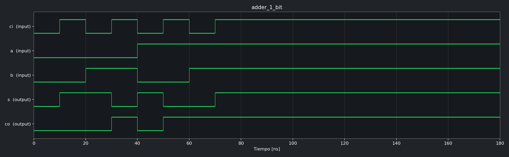

### Ejercicio 2 - Sumador completo estructural de 4 bits

Se construye interconectando cuatro instancias del sumador de 1 bit mediante una
cadena de acarreos.

```verilog
module adder_4_bits(
    input ci,
    input  [4-1:0] a,
    input  [4-1:0] b,
    output [4-1:0] s,
    output co
    );
```

[Fuente](MYS_CESE/MYS_CESE.srcs/sources_1/new/adder_4_bits.v) ·
[Testbench Verilog](MYS_CESE/MYS_CESE.srcs/sim_1/imports/new/adder_4_bit_tb.v) ·
[Test Cocotb](cocotb/test_adder_4_bits.py) ·
[VCD](cocotb/waveforms/adder_4_bits.vcd)

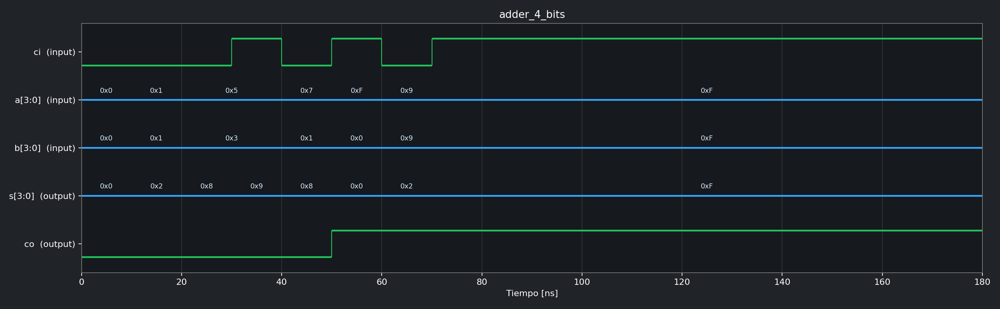

### Ejercicio 3 - Sumador/restador de 4 bits

`sr=1'b0` selecciona suma. Con `sr=1'b1` se complementa `b` y se utiliza el
acarreo de entrada para efectuar la resta en complemento a dos.

```verilog
module sum_res_4_bits(
    input sr,
    input  [4-1:0] a,
    input  [4-1:0] b,
    output [4-1:0] s,
    output co
    );
```

[Fuente](MYS_CESE/MYS_CESE.srcs/sources_1/new/sum_res_4_bits.v) ·
[Testbench Verilog](MYS_CESE/MYS_CESE.srcs/sim_1/imports/new/sum_res_4_bits_tb.v) ·
[Test Cocotb](cocotb/test_sum_res_4_bits.py) ·
[VCD](cocotb/waveforms/sum_res_4_bits.vcd)

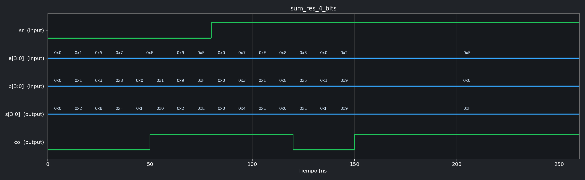

### Ejercicio 4 - Multiplexor 2 a 1

```verilog
module mux_2_a_1(
    input a,
    input b,
    input sel,
    output mux
    );
```

[Fuente](MYS_CESE/MYS_CESE.srcs/sources_1/new/mux_2_a_1.v) ·
[Testbench Verilog](MYS_CESE/MYS_CESE.srcs/sim_1/imports/new/mux_2_a_1_tb.v) ·
[Test Cocotb](cocotb/test_mux_2_a_1.py) ·
[VCD](cocotb/waveforms/mux_2_a_1.vcd)

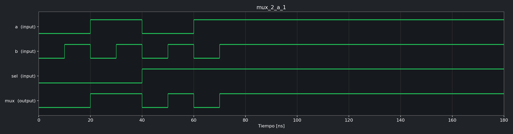

### Ejercicio 5 - Flip-flop D con reset y habilitación

El dato se almacena en el flanco ascendente cuando `ena=1'b1`. El reset es
síncrono.

```verilog
module ffd(
    input d,
    input ena,
    input rst,
    input clk,
    output reg q
    );
```

[Fuente](MYS_CESE/MYS_CESE.srcs/sources_1/new/ffd.v) ·
[Testbench Verilog](MYS_CESE/MYS_CESE.srcs/sim_1/imports/new/ffd_tb.v) ·
[Test Cocotb](cocotb/test_ffd.py) · [VCD](cocotb/waveforms/ffd.vcd)

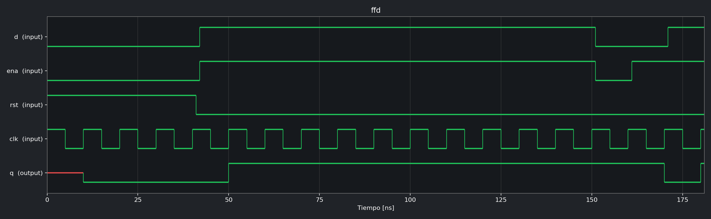

### Ejercicio 6 - Registro de desplazamiento estructural

Registro SISO de 4 bits construido con cuatro instancias de `ffd`.

```verilog
module reg_desp_estructural(
    input E,
    output S,
    input rst,
    input clk
    );
```

[Fuente](MYS_CESE/MYS_CESE.srcs/sources_1/new/reg_desp_estructural.v) ·
[Testbench Verilog](MYS_CESE/MYS_CESE.srcs/sim_1/imports/new/reg_desp_estructural_tb.v) ·
[Test Cocotb](cocotb/test_reg_desp_estructural.py) ·
[VCD](cocotb/waveforms/reg_desp_estructural.vcd)

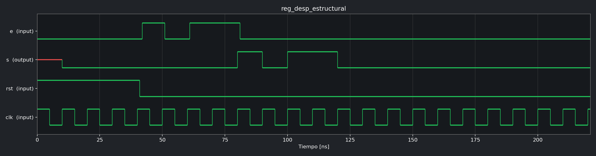

### Ejercicio 7 - Registro de desplazamiento por comportamiento

Describe el mismo registro SISO con un único proceso secuencial.

```verilog
module reg_desp_comportamiento(
    input E,
    output S,
    input rst,
    input clk
    );
```

[Fuente](MYS_CESE/MYS_CESE.srcs/sources_1/new/reg_desp_comportamiento.v) ·
[Testbench Verilog](MYS_CESE/MYS_CESE.srcs/sim_1/imports/new/reg_desp_comportamiento_tb.v) ·
[Test Cocotb](cocotb/test_reg_desp_comportamiento.py) ·
[VCD](cocotb/waveforms/reg_desp_comportamiento.vcd)

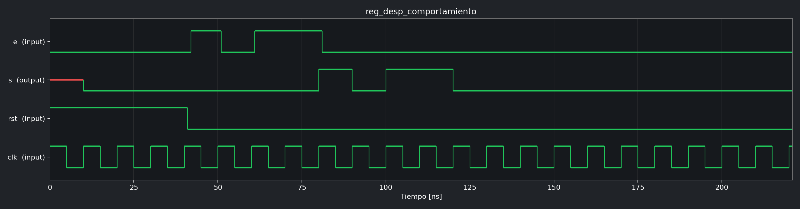

### Ejercicio 8 - Barrel shifter genérico por comportamiento

Desplaza lógicamente hacia la derecha la palabra `a`. `des` indica la cantidad
de posiciones. Los valores predeterminados implementan una palabra de 8 bits.

```verilog
module barrel_shifter #(
    parameter N = 8,
    parameter M = 3
)(
    input  [N-1:0] a,
    input  [M-1:0] des,
    output [N-1:0] s
    );
```

[Fuente](MYS_CESE/MYS_CESE.srcs/sources_1/new/barrel_shifter.v) ·
[Testbench Verilog](MYS_CESE/MYS_CESE.srcs/sim_1/imports/new/barrel_shifter_tb.v) ·
[Test Cocotb](cocotb/test_barrel_shifter.py) ·
[VCD](cocotb/waveforms/barrel_shifter.vcd)

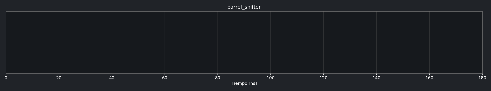

### Ejercicio 9 - Barrel shifter estructural con multiplexores

Implementación fija de 8 bits organizada en etapas de desplazamiento de 1, 2 y
4 posiciones, seleccionadas mediante multiplexores 2 a 1.

```verilog
module barrel_shifter_mux(
    input  [8-1:0] a,
    input  [3-1:0] des,
    output [8-1:0] s
    );
```

[Fuente](MYS_CESE/MYS_CESE.srcs/sources_1/new/barrel_shifter_mux.v) ·
[Testbench Verilog](MYS_CESE/MYS_CESE.srcs/sim_1/imports/new/barrel_shifter_mux_tb.v) ·
[Test Cocotb](cocotb/test_barrel_shifter_mux.py) ·
[VCD](cocotb/waveforms/barrel_shifter_mux.vcd)

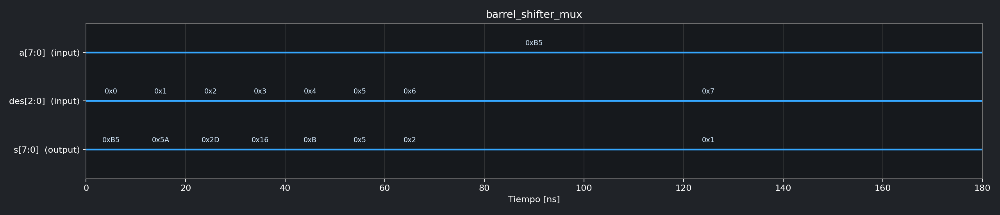

### Ejercicio 10 - Contador estructural de 4 bits

Se forma interconectando cuatro celdas unitarias. La habilitación se propaga
entre etapas y la salida avanza en binario cuando `ena=1'b1`.

```verilog
module contador_binario_4_bits(
    input ena,
    input rst,
    input clk,
    output [4-1:0] q
    );
```

[Fuente](MYS_CESE/MYS_CESE.srcs/sources_1/new/contador_binario_4_bits.v) ·
[Testbench Verilog](MYS_CESE/MYS_CESE.srcs/sim_1/imports/new/contador_binario_4_bits_tb.v) ·
[Test Cocotb](cocotb/test_contador_binario_4_bits.py) ·
[VCD](cocotb/waveforms/contador_binario_4_bits.vcd)

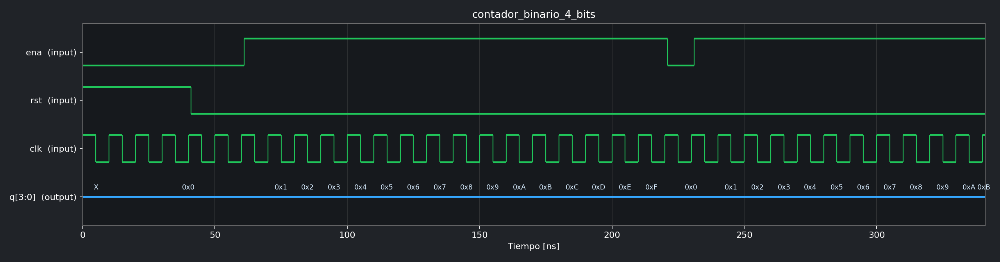

### Ejercicio 11 - Contador de 4 bits por comportamiento

```verilog
module contador_binario_4_bits_comportamiento(
    input ena,
    input rst,
    input clk,
    output reg[4-1:0] q
    );
```

[Fuente](MYS_CESE/MYS_CESE.srcs/sources_1/new/contador_binario_4_bits_comportamiento.v) ·
[Testbench Verilog](MYS_CESE/MYS_CESE.srcs/sim_1/imports/new/contador_binario_4_bits_comportamiento_tb.v) ·
[Test Cocotb](cocotb/test_contador_binario_4_bits_comportamiento.py) ·
[VCD](cocotb/waveforms/contador_binario_4_bits_comportamiento.vcd)

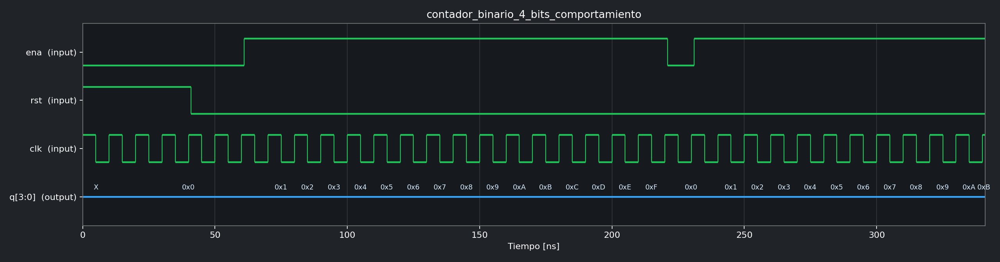

### Ejercicio 12 - Contador estructural genérico de N bits

El `for generate` instancia una celda unitaria por cada bit.

```verilog
module contador_binario_N_bits_estructural#(
    parameter N = 4
)(
    input ena,
    input rst,
    input clk,
    output [N-1:0] q
    );
```

[Fuente](MYS_CESE/MYS_CESE.srcs/sources_1/new/contador_binario_N_bits_estructural.v) ·
[Testbench Verilog](MYS_CESE/MYS_CESE.srcs/sim_1/imports/new/contador_binario_N_bits_estructural_tb.v) ·
[Test Cocotb](cocotb/test_contador_binario_N_bits_estructural.py) ·
[VCD](cocotb/waveforms/contador_binario_N_bits_estructural.vcd)

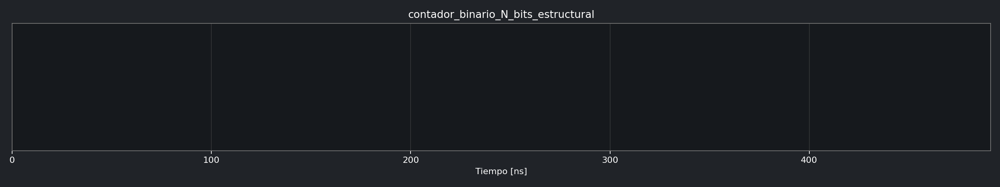

### Ejercicio 13 - Contador genérico de N bits por comportamiento

```verilog
module contador_binario_N_bits_comportamiento#(
    parameter N = 4
)(
    input ena,
    input rst,
    input clk,
    output reg [N-1:0] q
    );
```

[Fuente](MYS_CESE/MYS_CESE.srcs/sources_1/new/contador_binario_N_bits_comportamiento.v) ·
[Testbench Verilog](MYS_CESE/MYS_CESE.srcs/sim_1/imports/new/contador_binario_N_bits_comportamiento_tb.v) ·
[Test Cocotb](cocotb/test_contador_binario_N_bits_comportamiento.py) ·
[VCD](cocotb/waveforms/contador_binario_N_bits_comportamiento.vcd)

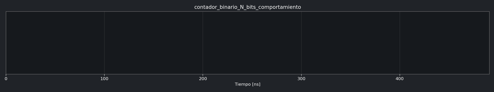

### Ejercicio 14 - Contador BCD estructural de un dígito

Utiliza un sumador de 4 bits como incrementador, un comparador genérico cargado
con 9 y un registro genérico de 4 bits. `co` indica el fin de cuenta del dígito.

```verilog
module contador_bcd(
    input ena,
    input rst,
    input clk,
    output [4-1:0] q,
    output co
    );
```

[Fuente](MYS_CESE/MYS_CESE.srcs/sources_1/new/contador_bcd.v) ·
[Testbench Verilog](MYS_CESE/MYS_CESE.srcs/sim_1/imports/new/contador_bcd_tb.v) ·
[Test Cocotb](cocotb/test_contador_bcd.py) ·
[VCD](cocotb/waveforms/contador_bcd.vcd)

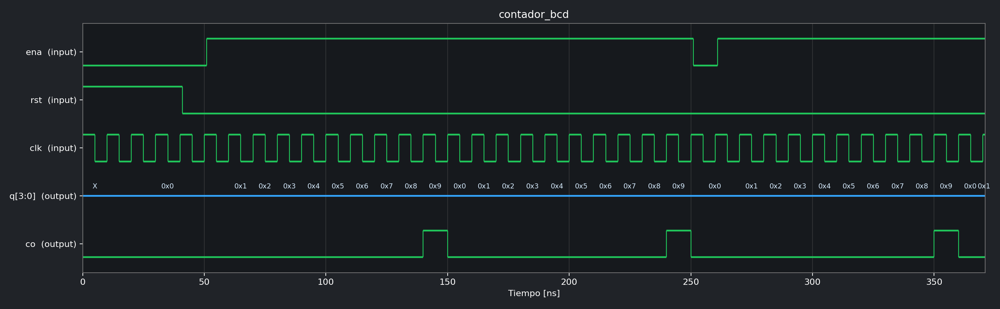

### Ejercicio 15 - Contador BCD por comportamiento

Implementa la cuenta de 0 a 9 y el retorno a cero mediante lógica combinacional
y un proceso secuencial para el registro.

```verilog
module contador_bcd_comportamiento(
    input ena,
    input rst,
    input clk,
    output reg[4-1:0] q
    );
```

[Fuente](MYS_CESE/MYS_CESE.srcs/sources_1/new/contador_bcd_comportamiento.v) ·
[Testbench Verilog](MYS_CESE/MYS_CESE.srcs/sim_1/imports/new/contador_bcd_comportamiento_tb.v) ·
[Test Cocotb](cocotb/test_contador_bcd_comportamiento.py) ·
[VCD](cocotb/waveforms/contador_bcd_comportamiento.vcd)

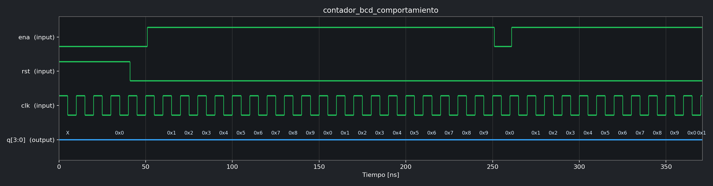

### Ejercicio 16 - Contador BCD de 4 dígitos

Instancia cuatro contadores BCD y encadena la habilitación de cada dígito con el
fin de cuenta del dígito anterior. Cuenta desde `0000` hasta `9999`.

```verilog
module contador_bcd_4_digitos(
    input ena,
    input rst,
    input clk,
    output[4-1:0] bcd0,
    output[4-1:0] bcd1,
    output[4-1:0] bcd2,
    output[4-1:0] bcd3,
    output co
    );
```

[Fuente](MYS_CESE/MYS_CESE.srcs/sources_1/new/contador_bcd_4_digitos.v) ·
[Testbench Verilog](MYS_CESE/MYS_CESE.srcs/sim_1/imports/new/contador_bcd_4_digitos_tb.v) ·
[Test Cocotb](cocotb/test_contador_bcd_4_digitos.py) ·
[VCD](cocotb/waveforms/contador_bcd_4_digitos.vcd)

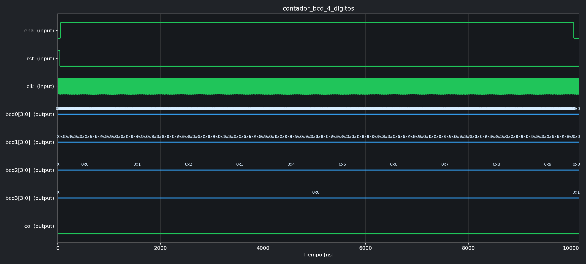

### Ejercicio 17 - Generador de habilitación cada N ciclos

La salida `s` permanece activa durante un ciclo de reloj cada `N` ciclos.

```verilog
module contador_N_clk#(
    parameter N = 5,
    parameter M = $clog2(N)
)(
    input rst,
    input clk,
    output s
    );
```

[Fuente](MYS_CESE/MYS_CESE.srcs/sources_1/new/contador_N_clk.v) ·
[Testbench Verilog](MYS_CESE/MYS_CESE.srcs/sim_1/imports/new/contador_N_clk_tb.v) ·
[Test Cocotb](cocotb/test_contador_N_clk.py) ·
[VCD](cocotb/waveforms/contador_N_clk.vcd)

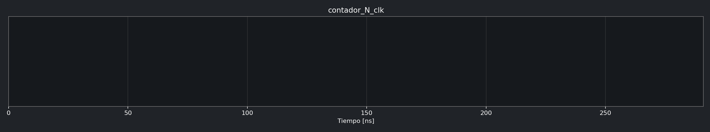

### Ejercicio 18 - Contador BCD con avance cada segundo

Top level que combina el generador de habilitación con el contador BCD. En el
hardware, `SYS_CLK` representa la frecuencia del reloj del sistema; durante la
simulación se reemplaza por un valor pequeño para evitar millones de ciclos.

```verilog
module contador_bcd_1_seg#(
    parameter SYS_CLK = 100000000
)(
    input ena,
    input rst,
    input clk,
    output [3:0] q
    );
```

[Fuente](MYS_CESE/MYS_CESE.srcs/sources_1/new/contador_bcd_1_seg.v) ·
[Testbench Verilog](MYS_CESE/MYS_CESE.srcs/sim_1/imports/new/contador_bcd_1_seg_tb.v) ·
[Test Cocotb](cocotb/test_contador_bcd_1_seg.py) ·
[VCD](cocotb/waveforms/contador_bcd_1_seg.vcd)

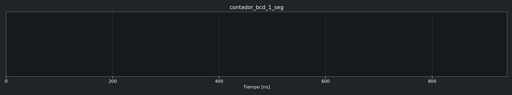

## Componentes auxiliares

Estos bloques se verifican indirectamente a través de los circuitos estructurales
que los instancian.

### Celda unitaria del contador binario

```verilog
module celda_unitaria_contador_binario(
    input ena_in,
    input rst,
    input clk,
    output q,
    output ena_out
    );
```

[Fuente](MYS_CESE/MYS_CESE.srcs/sources_1/new/celda_unitaria_contador_binario.v)

### Comparador genérico

```verilog
module comparador_igual#(
    parameter N = 4
)(
    input [N-1:0] a,
    input [N-1:0] b,
    output igual
    );
```

[Fuente](MYS_CESE/MYS_CESE.srcs/sources_1/new/comparador_igual.v)

### Registro genérico

```verilog
module registro_N_bits#(
    parameter N = 8
)(
    input [N-1:0] d,
    input ena,
    input rst,
    input clk,
    output reg[N-1:0] q
    );
```

[Fuente](MYS_CESE/MYS_CESE.srcs/sources_1/new/registro_N_bits.v)


